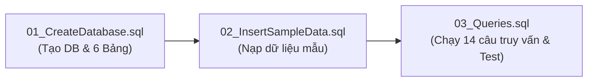

# LAB 10: THIẾT KẾ VÀ CÀI ĐẶT CƠ SỞ DỮ LIỆU EduManagerDB BẰNG SQL SERVER

## 📌 Giới thiệu tổng quan
**LAB 10** là bài thực hành chuyên sâu về thiết kế và xây dựng cơ sở dữ liệu quan hệ (**Relational Database**) phục vụ hệ thống quản lý đào tạo sinh viên mang tên **`EduManagerDB`** trên hệ quản trị cơ sở dữ liệu **Microsoft SQL Server**. Bài thực hành cung cấp đầy đủ các kịch bản T-SQL từ tạo cơ sở dữ liệu, định nghĩa bảng với các ràng buộc toàn vẹn, nạp dữ liệu mẫu theo thứ tự quan hệ logic, đến viết các câu truy vấn nâng cao (JOIN, LIKE, GROUP BY, HAVING, AVG, COUNT) và kiểm thử tính đúng đắn của các ràng buộc nghiệp vụ.

---

## 🎯 Mục tiêu bài thực hành
1. Thiết kế cơ sở dữ liệu quan hệ chuẩn hóa cho bài toán quản lý sinh viên.
2. Viết mã T-SQL tạo database, bảng, khóa chính (`PRIMARY KEY`), khóa ngoại (`FOREIGN KEY`) và các ràng buộc dữ liệu (`CHECK`, `DEFAULT`).
3. Nhập dữ liệu mẫu tuân thủ đúng thứ tự ràng buộc cha - con giữa các bảng.
4. Hiện thực các dạng câu truy vấn cơ bản và nâng cao: `SELECT`, `INNER JOIN`, `LEFT JOIN`, `LIKE`, `GROUP BY`, `HAVING`, `UPDATE` và `DELETE`.
5. Thiết kế các ca kiểm thử (Constraint Testing) với dữ liệu sai quy cách để xác nhận cơ chế bảo vệ của SQL Server hoạt động chính xác.

---

## 🛠️ Công nghệ & Công cụ thực hiện
- **Hệ quản trị CSDL:** Microsoft SQL Server (2019 / 2022 hoặc SQL Server Express).
- **Ngôn ngữ:** Transact-SQL (T-SQL).
- **Công cụ thực thi & quản trị:** SQL Server Management Studio (SSMS) hoặc Azure Data Studio hoặc Visual Studio SQL Server Object Explorer.

---

## 📁 Cấu trúc thư mục sản phẩm
```text
LAB10/
├── 01_CreateDatabase.sql       # Kịch bản tạo Database và 6 bảng với ràng buộc toàn vẹn
├── 02_InsertSampleData.sql      # Kịch bản nạp dữ liệu mẫu hợp lệ theo thứ tự quan hệ
├── 03_Queries.sql               # Kịch bản thực thi 14 truy vấn (CRUD, Thống kê, Test lỗi)
└── Readme.md                    # Báo cáo kết quả và tài liệu hướng dẫn chi tiết
```

---

## 🗄️ Thiết kế Cơ sở dữ liệu (`EduManagerDB`)

### 1. Danh sách 6 bảng bắt buộc

| Tên bảng | Khóa chính (PK) | Khóa ngoại (FK) | Ràng buộc nghiệp vụ (Constraints) | Ghi chú |
|---|---|---|---|---|
| **`KHOA`** | `MaKhoa` | *(Không)* | Khóa chính duy nhất | Lưu thông tin các khoa đào tạo |
| **`LOP`** | `MaLop` | `MaKhoa` $ \rightarrow $ `KHOA(MaKhoa)` | `ON UPDATE CASCADE` | Mỗi lớp trực thuộc một khoa |
| **`SINHVIEN`** | `MaSV` | `MaLop` $ \rightarrow $ `LOP(MaLop)` | `CK_SINHVIEN_GioiTinh`: `IN (N'Nam', N'Nữ')` | Lưu hồ sơ sinh viên |
| **`MONHOC`** | `MaMH` | *(Không)* | `CK_MONHOC_SoTinChi`: `SoTinChi > 0` | Danh mục môn học |
| **`KETQUA`** | `(MaSV, MaMH)` | `MaSV` $ \rightarrow $ `SINHVIEN(MaSV)`<br>`MaMH` $ \rightarrow $ `MONHOC(MaMH)` | `CK_KETQUA_Diem`: `Diem BETWEEN 0 AND 10`<br>`ON DELETE CASCADE` | Lưu điểm thi theo môn của sinh viên |
| **`TAIKHOAN`** | `TenDangNhap` | *(Không)* | `DF_VaiTro`: `'User'`, `DF_TrangThai`: `1` | Lưu tài khoản đăng nhập demo |

### 2. Sơ đồ quan hệ thực thể (ERD)
```text
[KHOA] 1 ──────────── ∞ [LOP] 1 ──────────── ∞ [SINHVIEN] 1
                                                     │
                                                     │ 1
                                                     │
[MONHOC] 1 ──────────────────────────────────── ∞ [KETQUA]
```

---

## 🚀 Quy trình thực thi các Script T-SQL

Để hệ thống hoạt động chính xác và không gặp lỗi vi phạm ràng buộc dữ liệu, **bắt buộc chạy 3 file theo đúng thứ tự sau**:



1. Mở **SSMS** và kết nối tới SQL Server instance của bạn (ví dụ: `.\SQLEXPRESS`).
2. Mở và thực thi file **`01_CreateDatabase.sql`** (bấm `Execute` hoặc phím `F5`).
3. Mở và thực thi file **`02_InsertSampleData.sql`**.
4. Mở và thực thi file **`03_Queries.sql`** để kiểm tra toàn bộ kết quả.

---

## 📊 Kết quả thực thi chi tiết (Các truy vấn trong `03_Queries.sql`)

### Câu 1: Liệt kê toàn bộ sinh viên
```sql
SELECT MaSV, HoTen, CONVERT(VARCHAR(10), NgaySinh, 103) AS NgaySinhFormatted, GioiTinh, MaLop
FROM SINHVIEN ORDER BY MaSV ASC;
```
**Kết quả hiển thị:**
| MaSV | HoTen | NgaySinhFormatted | GioiTinh | MaLop |
|---|---|---|---|---|
| SV001 | Nguyễn Văn An | 10/02/2005 | Nam | CNTT01 |
| SV002 | Trần Thị Bình | 21/08/2005 | Nữ | CNTT01 |
| SV003 | Lê Minh Chi | 02/12/2004 | Nữ | CNTT02 |
| SV004 | Phạm Quốc Dung | 16/04/2005 | Nam | CNTT02 |
| SV005 | Hoàng Gia Hân | 30/10/2005 | Nữ | SPTIN01 |
| SV006 | Võ Thành Khang | 09/09/2004 | Nam | SPTIN01 |

---

### Câu 2: Liệt kê sinh viên kèm tên lớp và tên khoa
```sql
SELECT sv.MaSV, sv.HoTen, l.TenLop, k.TenKhoa
FROM SINHVIEN sv
INNER JOIN LOP l ON sv.MaLop = l.MaLop
INNER JOIN KHOA k ON l.MaKhoa = k.MaKhoa;
```
**Kết quả hiển thị:**
| MaSV | HoTen | TenLop | TenKhoa |
|---|---|---|---|
| SV001 | Nguyễn Văn An | Công nghệ thông tin 01 | Khoa Công nghệ Thông tin |
| SV002 | Trần Thị Bình | Công nghệ thông tin 01 | Khoa Công nghệ Thông tin |
| SV003 | Lê Minh Chi | Công nghệ thông tin 02 | Khoa Công nghệ Thông tin |
| SV004 | Phạm Quốc Dung | Công nghệ thông tin 02 | Khoa Công nghệ Thông tin |
| SV005 | Hoàng Gia Hân | Sư phạm Tin học 01 | Khoa Toán - Tin học |
| SV006 | Võ Thành Khang | Sư phạm Tin học 01 | Khoa Toán - Tin học |

---

### Câu 3: Tìm sinh viên theo một phần họ tên bằng LIKE
```sql
SELECT MaSV, HoTen, GioiTinh, MaLop
FROM SINHVIEN WHERE HoTen LIKE N'%An%' ORDER BY HoTen ASC;
```
**Kết quả hiển thị:** Tìm thấy `SV001` (Nguyễn Văn An) và `SV005` (Hoàng Gia Hân).

---

### Câu 4: Liệt kê danh sách sinh viên theo mã lớp (`CNTT01`)
```sql
SELECT MaSV, HoTen, NgaySinh, GioiTinh
FROM SINHVIEN WHERE MaLop = 'CNTT01' ORDER BY MaSV ASC;
```
**Kết quả hiển thị:**
| MaSV | HoTen | NgaySinh | GioiTinh |
|---|---|---|---|
| SV001 | Nguyễn Văn An | 2005-02-10 | Nam |
| SV002 | Trần Thị Bình | 2005-08-21 | Nữ |

---

### Câu 5: Cập nhật thông tin sinh viên
```sql
UPDATE SINHVIEN SET HoTen = N'Nguyễn Văn An (Đã cập nhật)' WHERE MaSV = 'SV001';
```
**Kết quả:** Dòng dữ liệu của `SV001` được cập nhật thành công với giá trị mới.

---

### Câu 6: Xóa sinh viên chưa có dữ liệu điểm
```sql
DELETE FROM SINHVIEN
WHERE MaSV = 'SV003' 
  AND NOT EXISTS (SELECT 1 FROM KETQUA WHERE MaSV = 'SV003');
```
**Kết quả:** Sinh viên `SV003` chưa có bản ghi nào trong bảng `KETQUA` nên được xóa an toàn mà không phát sinh lỗi khóa ngoại.

---

### Câu 7: Liệt kê điểm của từng sinh viên theo từng môn học
```sql
SELECT sv.MaSV, sv.HoTen, mh.TenMH, mh.SoTinChi, kq.Diem
FROM KETQUA kq
INNER JOIN SINHVIEN sv ON kq.MaSV = sv.MaSV
INNER JOIN MONHOC mh ON kq.MaMH = mh.MaMH
ORDER BY sv.MaSV ASC, mh.TenMH ASC;
```
**Kết quả hiển thị:**
| MaSV | HoTen | TenMH | SoTinChi | Diem |
|---|---|---|---|---|
| SV001 | Nguyễn Văn An (Đã cập nhật) | Cơ sở dữ liệu | 3 | 7.50 |
| SV001 | Nguyễn Văn An (Đã cập nhật) | Lập trình trên Windows | 3 | 8.50 |
| SV002 | Trần Thị Bình | Cơ sở dữ liệu | 3 | 8.00 |
| SV002 | Trần Thị Bình | Lập trình trên Windows | 3 | 9.00 |
| SV004 | Phạm Quốc Dung | Cơ sở dữ liệu | 3 | 6.50 |
| SV004 | Phạm Quốc Dung | Lập trình trên Windows | 3 | 7.00 |
| SV005 | Hoàng Gia Hân | Lập trình cơ bản | 3 | 8.00 |
| SV006 | Võ Thành Khang | Nhập môn Công nghệ phần mềm | 3 | 7.80 |

---

### Câu 8: Tính điểm trung bình của từng sinh viên
```sql
SELECT sv.MaSV, sv.HoTen, 
       ROUND(AVG(CAST(kq.Diem AS FLOAT)), 2) AS DiemTrungBinh,
       COUNT(kq.MaMH) AS SoMonDaHoc
FROM SINHVIEN sv
INNER JOIN KETQUA kq ON sv.MaSV = kq.MaSV
GROUP BY sv.MaSV, sv.HoTen
ORDER BY DiemTrungBinh DESC;
```
**Kết quả hiển thị:**
| MaSV | HoTen | DiemTrungBinh | SoMonDaHoc |
|---|---|---|---|
| SV002 | Trần Thị Bình | 8.50 | 2 |
| SV001 | Nguyễn Văn An (Đã cập nhật) | 8.00 | 2 |
| SV005 | Hoàng Gia Hân | 8.00 | 1 |
| SV006 | Võ Thành Khang | 7.80 | 1 |
| SV004 | Phạm Quốc Dung | 6.75 | 2 |

---

### Câu 9: Thống kê số lượng sinh viên theo từng lớp
```sql
SELECT l.MaLop, l.TenLop, COUNT(sv.MaSV) AS SoSinhVien
FROM LOP l
LEFT JOIN SINHVIEN sv ON l.MaLop = sv.MaLop
GROUP BY l.MaLop, l.TenLop
ORDER BY SoSinhVien DESC;
```
**Kết quả hiển thị:**
| MaLop | TenLop | SoSinhVien |
|---|---|---|
| CNTT01 | Công nghệ thông tin 01 | 2 |
| SPTIN01 | Sư phạm Tin học 01 | 2 |
| CNTT02 | Công nghệ thông tin 02 | 1 |

---

### Câu 10: Liệt kê các lớp có từ 2 sinh viên trở lên (HAVING)
```sql
SELECT l.MaLop, l.TenLop, COUNT(sv.MaSV) AS SoSinhVien
FROM LOP l
LEFT JOIN SINHVIEN sv ON l.MaLop = sv.MaLop
GROUP BY l.MaLop, l.TenLop
HAVING COUNT(sv.MaSV) >= 2;
```
**Kết quả hiển thị:** Chỉ gồm 2 lớp `CNTT01` và `SPTIN01`.

---

## 🧪 Kết quả kiểm thử các ràng buộc toàn vẹn (Constraints Testing)

### Ca kiểm thử 11: Thêm sinh viên vào lớp không tồn tại (`CNTT99`)
- **Câu lệnh test:**
  ```sql
  INSERT INTO SINHVIEN (MaSV, HoTen, NgaySinh, GioiTinh, MaLop)
  VALUES ('SV999', N'Sinh viên lỗi', '2005-01-01', N'Nam', 'CNTT99');
  ```
- **Kết quả trả về từ SQL Server:**
  > `Msg 547, Level 16, State 0, Line 1`  
  > `The INSERT statement conflicted with the FOREIGN KEY constraint "FK_SINHVIEN_LOP". The conflict occurred in database "EduManagerDB", table "dbo.LOP", column 'MaLop'.`
- **Kết luận:**- Khóa ngoại ngăn chặn thành công việc nhập dữ liệu mồ côi.

---

### Ca kiểm thử 12: Nhập điểm thi vượt quá thang điểm 10 (`Diem = 12.5`)
- **Câu lệnh test:**
  ```sql
  INSERT INTO KETQUA (MaSV, MaMH, Diem)
  VALUES ('SV001', 'COMP1019', 12.5);
  ```
- **Kết quả trả về từ SQL Server:**
  > `Msg 547, Level 16, State 0, Line 1`  
  > `The INSERT statement conflicted with the CHECK constraint "CK_KETQUA_Diem". The conflict occurred in database "EduManagerDB", table "dbo.KETQUA", column 'Diem'.`
- **Kết luận:**- Ràng buộc `CHECK` ngăn chặn nhập sai biên giá trị điểm thi.

---

### Ca kiểm thử 13: Nhập giới tính không thuộc Nam hoặc Nữ (`GioiTinh = N'Khác'`)
- **Câu lệnh test:**
  ```sql
  INSERT INTO SINHVIEN (MaSV, HoTen, NgaySinh, GioiTinh, MaLop)
  VALUES ('SV998', N'Sinh viên sai giới tính', '2005-01-01', N'Khác', 'CNTT01');
  ```
- **Kết quả trả về từ SQL Server:**
  > `Msg 547, Level 16, State 0, Line 1`  
  > `The INSERT statement conflicted with the CHECK constraint "CK_SINHVIEN_GioiTinh". The conflict occurred in database "EduManagerDB", table "dbo.SINHVIEN", column 'GioiTinh'.`
- **Kết luận:**- Ràng buộc miền giá trị `CHECK IN` hoạt động chính xác.

---

### Ca kiểm thử 14: Thêm trùng mã sinh viên (`MaSV = 'SV001'`)
- **Câu lệnh test:**
  ```sql
  INSERT INTO SINHVIEN (MaSV, HoTen, NgaySinh, GioiTinh, MaLop)
  VALUES ('SV001', N'Nguyễn Văn Trùng Mã', '2005-01-01', N'Nam', 'CNTT01');
  ```
- **Kết quả trả về từ SQL Server:**
  > `Msg 2627, Level 14, State 1, Line 1`  
  > `Violation of PRIMARY KEY constraint 'PK_SINHVIEN'. Cannot insert duplicate key in object 'dbo.SINHVIEN'. The duplicate key value is (SV001).`
- **Kết luận:**- Khóa chính bảo đảm tính duy nhất của thực thể.

---


